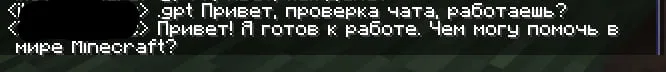

# Minecraft LLM UserChatBot

Юзербот для Minecraft, который использует LLM (Groq) для общения в чате. 
Скрипт читает `latest.log` в реальном времени, парсит сообщения, отправляет их в нейросеть и эмулирует ввод, чтобы напечатать ответ прямо в игре.

## Как это работает
1. Скрипт следит за `latest.log` (читает новые строки).
2. Когда находит строку с `[CHAT]`, он вытаскивает ник и текст сообщения.
3. **Не все команды отправляются в Groq** (например, `.roll`, `.spam`, `.caps` выполняются локально).
4. Ответ от Groq обрезается до 256 символов (лимит чата Minecraft). Мы надеемся, что сам пользователь не напишет в игру больше 256 символов, поэтому его сообщение не обрезается.
5. Готовый ответ вставляется через `pydirectinput` (эмуляция нажатий клавиш).

## Скриншот

## Установка
1. Клонируйте репозиторий:
   `git clone https://github.com/hakirimura/Minecraft-LLM-Chat-Userbot.git`
2. Создайте виртуальное окружение и активируйте его:
   `python -m venv .venv`
   `.venv\Scripts\activate` (Windows)
3. Установите зависимости:
   `pip install -r requirements.txt`
4. Скопируйте `config_example.py` в `config.py` и заполните:
   - `GROQ_API_KEY` — ваш ключ с console.groq.com
   - `LOGPATH` — путь к `latest.log` (обычно `C:\Users\...\AppData\Roaming\.minecraft\logs\latest.log`)
   - `NICKNAME` — ваш ник в Minecraft
5. Запустите:
   `python main.py`

## Команды
- `.gpt <текст>` — задать вопрос нейросети
- `.roll` — кубик (1-6)
- `.spam <кол-во> <текст>` — спам (по умолчанию 5 раз)
- `.caps <текст>` — написать КАПСОМ
- `.help` — список команд *(требует прав оператора, так как использует `/tellraw`)*

## Важно
- **Окно Minecraft должно быть в фокусе**. Если вы переключитесь на другое окно, бот начнет печатать туда.
- Бот использует буфер обмена (затирает то, что вы копировали).
- **FAILSAFE**: Если бот начинает чудить, резко уведите мышку в левый верхний угол экрана — скрипт экстренно остановится.
- Используйте на свой страх и риск. На публичных серверах за спам и юзерботов могут забанить.